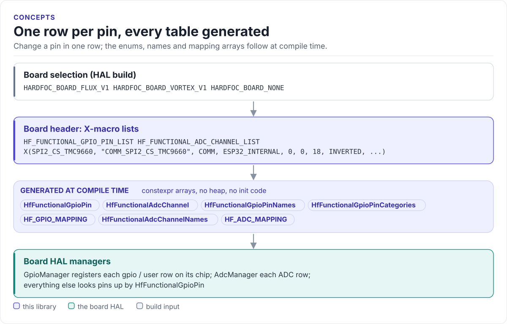

# Functional Pin Configuration

Header-only C++20 pin maps for HardFOC boards: what every pin does, which chip carries it and how it is driven, as
X-macro rows that the board HAL registers from at compile time.

[](https://github.com/hardfoc/hf-pincfg/actions/workflows/ci-cpp-lint.yml)
[](https://hardfoc.github.io/hf-pincfg/)
[](LICENSE)

**Documentation: <https://hardfoc.github.io/hf-pincfg/>**

<!-- figure: pin-model -->
<picture>
  <source media="(prefers-color-scheme: dark)" srcset="docs/diagrams/pin-model.dark.svg">
  
</picture>
<!-- /figure -->

## In 30 seconds

Define one board (`HARDFOC_BOARD_VORTEX_V1`, `HARDFOC_BOARD_FLUX_V1` or `HARDFOC_BOARD_NONE`), then:

<!-- generated: quickstart-code -->
```cpp
#include "hf_functional_pin_config.hpp"  // the build defines one HARDFOC_BOARD_* macro

// Print where every pin that the GPIO layer should own lives on this board.
void list_gpio_pins() {
  for (size_t i = 0; i < HF_GPIO_MAPPING_SIZE; ++i) {
    const HfGpioMapping& m = HF_GPIO_MAPPING[i];
    if (!should_register_as_gpio(static_cast<HfPinCategory>(m.category))) {
      continue;  // core and comm pins belong to the system and the bus drivers
    }
    std::printf("%-28.*s chip %u pin %2u %s\n", static_cast<int>(m.name.size()), m.name.data(),
                m.chip_type, m.physical_pin, m.is_inverted ? "active-low" : "active-high");
  }
}
```
<!-- /generated -->

## What it does

- Names every pin by function (`HfFunctionalGpioPin::SPI2_CS_TMC9660`), never by GPIO number.
- Puts pins on any chip: MCU, PCAL95555 I/O expander or TMC9660 GPIOs.
- Carries polarity, pull, drive mode and maximum current with each pin; resolution, full scale and divider with
  each ADC channel.
- Expands one X-macro list into the enums, name and category tables and `constexpr` mapping arrays.
- Selects the board at compile time; no heap, no SDK dependency.

## Install

```bash
git submodule add https://github.com/hardfoc/hf-pincfg.git external/hf-pincfg
```

```cmake
target_include_directories(my_hal PUBLIC external/hf-pincfg/src)
target_compile_definitions(my_hal PUBLIC HARDFOC_BOARD_VORTEX_V1=1)
```

Most projects get it through [hf-core-drivers](https://github.com/hardfoc/hf-core-drivers) as `internal/hf-pincfg`.

## Documentation

| | |
| --- | --- |
| [Quickstart](https://hardfoc.github.io/hf-pincfg/latest/quickstart/) | Select a board and read its map |
| [Pin model](https://hardfoc.github.io/hf-pincfg/latest/concepts/) | One X-macro row, every field |
| [Vortex V1 pin map](https://hardfoc.github.io/hf-pincfg/latest/vortex-v1/) | Generated from the header |
| [Flux V1 pin map](https://hardfoc.github.io/hf-pincfg/latest/flux-v1/) | Generated from the header |
| [Adding a board](https://hardfoc.github.io/hf-pincfg/latest/adding-a-board/) | A new header in five steps |
| [API reference](https://hardfoc.github.io/hf-pincfg/latest/api-reference/) | Doxygen |

## Tests

```bash
for b in VORTEX_V1 FLUX_V1; do c++ -std=c++20 -fsyntax-only -Isrc -DHARDFOC_BOARD_$b tests/docs/quickstart.cpp; done
```

## License

GPL-3.0; see [LICENSE](LICENSE).
