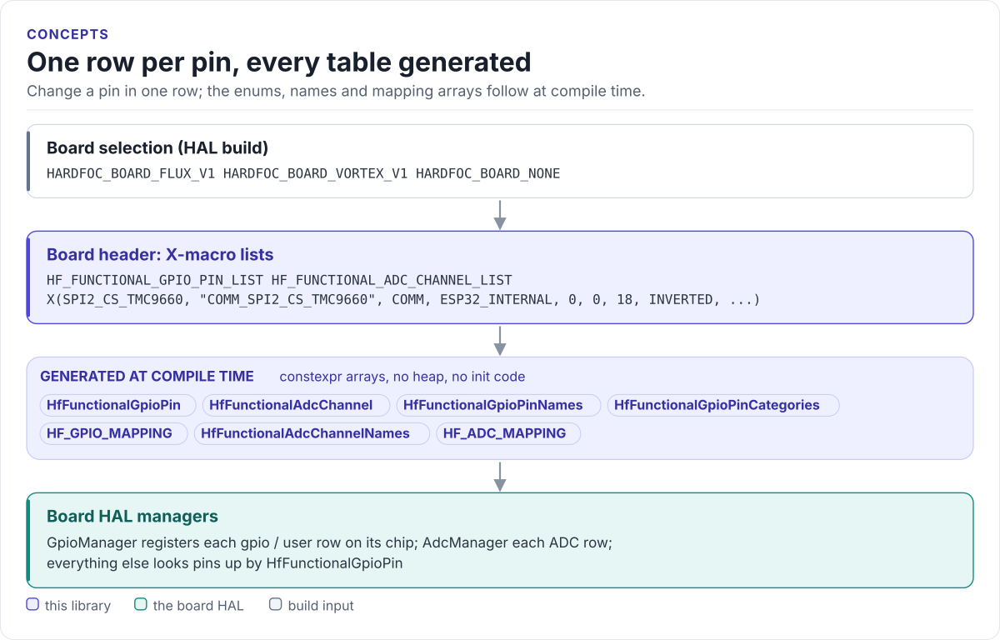

# Pin model

How one X-macro row describes a pin, what the rows expand into and who reads the result.

<!-- figure: pin-model -->
<picture>
  <source media="(prefers-color-scheme: dark)" srcset="diagrams/pin-model.dark.svg">
  
</picture>
<!-- /figure -->

## One row per function

Each board header defines two lists. `HF_FUNCTIONAL_GPIO_PIN_LIST(X)` has one `X(...)` row per digital pin;
`HF_FUNCTIONAL_ADC_CHANNEL_LIST(X)` one row per analog channel. This row from the Vortex V1 header is the TMC9660
chip select:

```cpp
X(SPI2_CS_TMC9660, "COMM_SPI2_CS_TMC9660", HfPinCategory::PIN_CATEGORY_COMM, HfGpioChipType::ESP32_INTERNAL,
  0, 0, 18, PIN_LOGIC_INVERTED, PIN_HAS_PULL, PIN_PULL_UP, PIN_PUSH_PULL, 40)
```

| Position | Field | In the example | Meaning |
| --- | --- | --- | --- |
| 1 | `ENUM_NAME` | `SPI2_CS_TMC9660` | Becomes `HfFunctionalGpioPin::SPI2_CS_TMC9660` |
| 2 | `STRING_NAME` | `"COMM_SPI2_CS_TMC9660"` | Name for logs and consoles; the prefix repeats the category |
| 3 | `CATEGORY` | `PIN_CATEGORY_COMM` | Who owns the pin (below) |
| 4 | `CHIP_TYPE` | `ESP32_INTERNAL` | Chip that carries the pin; each board header defines its own `HfGpioChipType` |
| 5 | `CHIP_UNIT` | `0` | Which instance of that chip (0 = first) |
| 6 | `GPIO_BANK` | `0` | Port or bank within the chip (0 = A) |
| 7 | `PHYSICAL_PIN` | `18` | Pin number within the bank: GPIO number on an ESP32, port bit 0 to 15 on a PCAL95555 |
| 8 | `LOGIC_INVERSION` | `PIN_LOGIC_INVERTED` | Active low |
| 9 | `HAS_PULL` | `PIN_HAS_PULL` | A pull resistor is enabled |
| 10 | `PULL_DIRECTION` | `PIN_PULL_UP` | Up or down; ignored without a pull |
| 11 | `OUTPUT_MODE` | `PIN_PUSH_PULL` | Push-pull or open-drain |
| 12 | `MAX_CURRENT_MA` | `40` | Maximum current (mA) |

An ADC row has ten fields: enum and string name, chip type, chip unit, ADC unit, physical channel, resolution
(bits), full-scale voltage (mV), divider ratio (`1.0f` = none) and a description.

## Categories

| Category | Prefix | Owned by | `should_register_as_gpio()` |
| --- | --- | --- | --- |
| `PIN_CATEGORY_CORE` | `CORE_` | The MCU itself: crystal, strapping, USB | false |
| `PIN_CATEGORY_COMM` | `COMM_` | A bus driver: SPI, UART, I²C, TWAI, LED data | false |
| `PIN_CATEGORY_GPIO` | `GPIO_` | The HAL's GPIO manager | true |
| `PIN_CATEGORY_USER` | | Application-defined pins | true |

`is_reserved_prefix()` tells whether a name starts with `CORE_`, `COMM_`, `SYS_` or `INTERNAL_`.

## What the rows expand into

Every board header expands its lists with the same `#define X(...)` / `#undef X` pattern:

| Generated | Type | Index |
| --- | --- | --- |
| `HfFunctionalGpioPin` | `enum class : uint8_t`, ends with `HF_FUNCTIONAL_GPIO_COUNT` | row order |
| `HfFunctionalGpioPinNames[]` | `std::string_view` | enum value |
| `HfFunctionalGpioPinCategories[]` | `HfPinCategory` | enum value |
| `HF_GPIO_MAPPING[]`, `HF_GPIO_MAPPING_SIZE` | `HfGpioMapping` | enum value |
| `HfFunctionalAdcChannel` | `enum class : uint8_t`, ends with `HF_FUNCTIONAL_ADC_COUNT` | row order |
| `HfFunctionalAdcChannelNames[]` | `std::string_view` | enum value |
| `HF_ADC_MAPPING[]`, `HF_ADC_MAPPING_SIZE` | `HfAdcMapping` | enum value |

Because the enum and the arrays come from the same rows, `HF_GPIO_MAPPING[static_cast<size_t>(pin)]` is always the
row of `pin`. The structures `HfGpioMapping` and `HfAdcMapping` and the category enum are shared by every board in
[`src/hf_functional_pin_config_base.hpp`](../src/hf_functional_pin_config_base.hpp).

## Board selection

[`src/hf_functional_pin_config.hpp`](../src/hf_functional_pin_config.hpp) includes one board header:

<!-- generated: boards -->
| Define | Board | MCU | Header | GPIO rows | ADC rows |
| --- | --- | --- | --- | --- | --- |
| `HARDFOC_BOARD_FLUX_V1` | Flux V1 | ESP32-S3 | `src/hf_functional_pin_config_flux_v1.hpp` | 27 | 14 |
| `HARDFOC_BOARD_VORTEX_V1` | Vortex V1 | ESP32-C6 | `src/hf_functional_pin_config_vortex_v1.hpp` | 34 | 15 |
| `HARDFOC_BOARD_NONE` | None (host builds) | none | `src/hf_functional_pin_config_none.hpp` | 0 | 0 |
<!-- /generated -->

`HARDFOC_BOARD_NONE` (or `HF_MCU_FAMILY_NONE`) selects an empty map for host builds: the enums have only their
`_COUNT` entry and every lookup returns `nullptr`. The repository also has
[`src/hf_functional_pin_config_pw_controller_v1.hpp`](../src/hf_functional_pin_config_pw_controller_v1.hpp), an
STM32H747 carrier profile that the selector does not include yet.

## Design choices

- **Primitive types only.** Board headers use `uint8_t`, `bool` and their own enums, so the library depends on no
  MCU SDK and no driver. The HAL casts `chip_type` back to its board's `HfGpioChipType`.
- **The header is the board's schematic in code.** Comments in the rows record wiring facts (for example, that
  TMC9660 GPIO17 and GPIO18 are also wired to PCAL95555 inputs P1 and P2).
- **No runtime registration code here.** The library only describes; the HAL decides how to create drivers.

Next: [API guide](api-guide.md).
