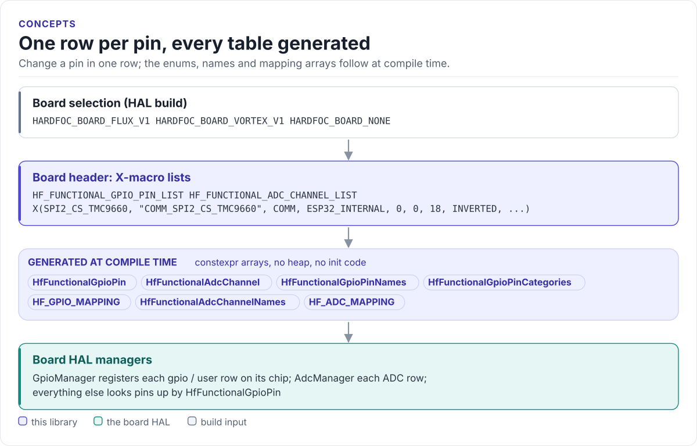

# Figures

<!-- Generated by hardfoc-docs figures from docs/diagrams/figures/*.py. Do not edit by hand. -->

Every figure on this site is drawn by a Python module from facts extracted from the code, so it is rebuilt,
not redrawn, when the code changes. CI runs `hardfoc-docs figures --check` and fails when a
committed figure no longer matches the code. Each figure below lists the files it is drawn from.

## One row per pin, every table generated

<!-- figure: pin-model -->
<picture>
  <source media="(prefers-color-scheme: dark)" srcset="pin-model.dark.svg">
  
</picture>
<!-- /figure -->

Figure module: [`docs/diagrams/figures/pin-model.py`](../../docs/diagrams/figures/pin-model.py)

Drawn from:

- `board selector` in [`src/hf_functional_pin_config.hpp`](../../src/hf_functional_pin_config.hpp)
- `X-macro lists and generated tables` in [`src/hf_functional_pin_config_vortex_v1.hpp`](../../src/hf_functional_pin_config_vortex_v1.hpp)
